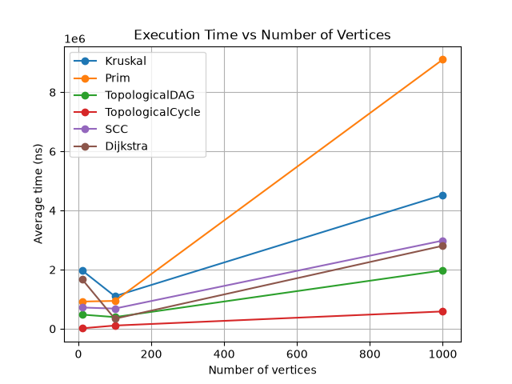

# Assignment 3 — Graph Algorithms

## Overview

This project models a smart city as a graph.

- Vertices represent city locations or districts.
- Edges represent roads or connections.
- Weights represent road cost or distance.

The project implements:

- Disjoint Set Union (DSU)
- Kruskal's algorithm
- Prim's algorithm
- Topological Sort
- Strongly Connected Components (Kosaraju)
- Dijkstra's algorithm

---

## Implementation

The graph is stored with an adjacency list.

For Minimum Spanning Tree:

- Kruskal sorts edges by weight and uses DSU.
- DSU uses path compression and union by size.
- Path compression makes the path to the root shorter.
- Union by size puts the smaller tree under the bigger tree.
- These two methods keep DSU operations fast.
- Prim uses a `PriorityQueue` and grows one tree from a start vertex.

For directed graphs:

- Topological Sort uses indegree and a queue.
- If not all vertices can be processed, the graph has a cycle.
- SCC uses Kosaraju's algorithm.

For shortest paths:

- Dijkstra uses a `PriorityQueue`.
- It finds the shortest distance from one source vertex to all reachable vertices.
- Negative edge weights are not allowed.
- Dijkstra can give a wrong result with negative weights because a path that looked shortest can become shorter later.

---

## Complexity Analysis

| Algorithm | Time Complexity | Space Complexity |
|---|---|---|
| DSU `find` / `union` | O(α(V)) amortized | O(V) |
| Kruskal | O(E log V) | O(V + E) |
| Prim with binary heap | O(E log V) | O(V + E) |
| Topological Sort | O(V + E) | O(V) |
| Kosaraju SCC | O(V + E) | O(V + E) |
| Dijkstra with binary heap | O((V + E) log V) | O(V + E) |

`V` is the number of vertices and `E` is the number of edges.

---

## Experimental Setup

Three graph sizes were used:

| Size | Vertices | Edges |
|---|---:|---:|
| Small | 10 | 30 |
| Medium | 100 | 500 |
| Large | 1000 | 5000 |

A fixed random seed was used so the graphs can be generated again.

Each algorithm was run 5 times.

Execution time was measured with:

```java
System.nanoTime()
```

For MST, I first created a spanning tree and then added random edges. Because of this, the graph is always connected.

For DAG generation, every edge goes from a smaller vertex number to a bigger vertex number. Because of this, the graph cannot have a cycle.

For cyclic directed graphs, I first added:

```text
0 -> 1 -> 2 -> 0
```

and then added random edges.

All random edge weights are positive, so the generated graphs can be used with Dijkstra.

---

## Results

| Algorithm | V | E | Average Time (ns) | Edge Checks | Find Calls | Union Calls |
|---|---:|---:|---:|---:|---:|---:|
| Kruskal | 10 | 30 | 1,974,320 | 14 | 28 | 14 |
| Prim | 10 | 30 | 919,880 | 60 | 0 | 0 |
| Topological DAG | 10 | 30 | 478,560 | 60 | 0 | 0 |
| Topological Cycle | 10 | 30 | 14,580 | 30 | 0 | 0 |
| SCC | 10 | 30 | 718,340 | 90 | 0 | 0 |
| Dijkstra | 10 | 30 | 1,676,840 | 60 | 0 | 0 |
| Kruskal | 100 | 500 | 1,100,460 | 272 | 544 | 272 |
| Prim | 100 | 500 | 941,840 | 1000 | 0 | 0 |
| Topological DAG | 100 | 500 | 394,620 | 1000 | 0 | 0 |
| Topological Cycle | 100 | 500 | 108,440 | 515 | 0 | 0 |
| SCC | 100 | 500 | 682,540 | 1500 | 0 | 0 |
| Dijkstra | 100 | 500 | 338,700 | 1000 | 0 | 0 |
| Kruskal | 1000 | 5000 | 4,525,120 | 3313 | 6626 | 3313 |
| Prim | 1000 | 5000 | 9,106,800 | 10000 | 0 | 0 |
| Topological DAG | 1000 | 5000 | 1,975,540 | 10000 | 0 | 0 |
| Topological Cycle | 1000 | 5000 | 585,180 | 5046 | 0 | 0 |
| SCC | 1000 | 5000 | 2,982,060 | 15000 | 0 | 0 |
| Dijkstra | 1000 | 5000 | 2,805,640 | 10000 | 0 | 0 |

---

## Plots

### Execution Time vs Number of Vertices



### Execution Time vs Number of Edges


---

## Comparison and Discussion

Kruskal and Prim returned the same MST weight for connected graphs.

Kruskal sorts edges and uses DSU. Prim uses a priority queue and grows one tree.

For the largest graph, Kruskal was faster than Prim in this experiment.

Topological Sort on a DAG checks all edges when it calculates indegree and checks them again while processing the graph.

For a graph with a cycle, Topological Sort can stop before all vertices are processed.

Kosaraju SCC uses two DFS passes and also creates the reversed graph. Because of this, it checks more edges.

Dijkstra checks graph edges and uses a priority queue. Its execution time increased when the graph became larger.

The results generally follow the expected time complexities. Small execution times can have some JVM and JIT measurement noise.

---

## Testing

The program was tested with:

- a normal connected graph;
- a disconnected graph;
- a graph with multiple valid MSTs;
- duplicate edge weights;
- a graph with one vertex;
- a DAG;
- a directed graph with a cycle;
- SCC groups;
- Dijkstra shortest paths;
- an unreachable vertex;
- a negative edge weight for Dijkstra.

Kruskal and Prim were checked to return the same MST weight.

Topological Sort was checked on both DAG and cyclic graphs.

Every vertex was checked to belong to exactly one SCC.

Dijkstra was checked with non-negative weights and unreachable vertices.

---

## Conclusion

Kruskal and Prim are both useful for finding a minimum spanning tree. In this experiment, Kruskal was faster on the largest graph.

Topological Sort is useful when a directed graph has no cycle.

SCC is useful for finding groups of vertices that can reach each other.

Dijkstra is useful for finding shortest paths when edge weights are not negative.

As the number of vertices and edges increased, the algorithms generally needed more time and more operations.

---

## Project Structure

```text
assignment-3/
├── src/
│   ├── graph/
│   ├── dsu/
│   ├── mst/
│   ├── connectivity/
│   ├── shortestpath/
│   ├── Main.java
│   ├── Tests.java
│   └── Benchmark.java
├── results/
│   ├── tables/
│   │   └── benchmark.csv
│   └── plots/
│       ├── time_vs_vertices.png
│       └── time_vs_edges.png
└── README.md
```

---

## Run

Compile:

```bash
javac -d out src/graph/*.java src/dsu/*.java src/mst/*.java src/connectivity/*.java src/shortestpath/*.java src/Main.java src/Tests.java src/Benchmark.java
```

Run the main program:

```bash
java -cp out Main
```

Run tests:

```bash
java -cp out Tests
```

Run benchmark:

```bash
java -cp out Benchmark
```
